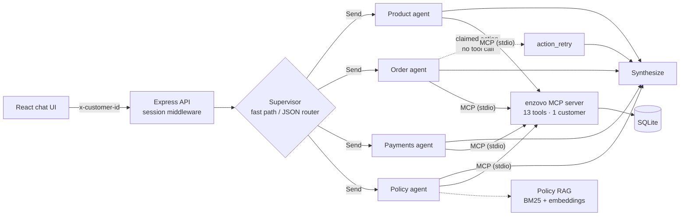

# enzovo_chat

[](https://github.com/allyan7/enzovo_chat/actions/workflows/ci.yml)
[](https://github.com/allyan7/enzovo_chat/actions/workflows/cd.yml)

-5b4bdb)


An agentic customer-support chatbot for an Indian e-commerce store. It tracks orders, explains refunds and wallet charges, answers policy questions with citations, and **places or cancels orders with one confirmation**, while asking the customer as few questions as possible. Everything runs on a laptop with a local 14B model.

**Multi-agent (LangGraph.js) · MCP tools · hybrid RAG · four-tier memory · human-in-the-loop · idempotent money writes · evals · CI/CD**

<!-- Demo: record a 60s GIF (buy → confirm → cancel with the inspector open) and save as docs/demo.gif -->

## Architecture



| Decision | Why |
|---|---|
| **Supervisor + 4 specialists** | Least privilege (the product agent can't touch the wallet) and 3–6 tools per agent, which a 14B model handles far better than 13 |
| **MCP between agents and business logic** | Same tools work from Claude Desktop or Cursor; identity is bound to the MCP process, so no tool takes a `customer_id` |
| **SQL for products, RAG for policies** | "Rated 4+ under ₹25,000" needs exact filters; policies are prose and get cited by section (`returns-and-refunds §6`) |
| **Confirmation enforced in code** | Write tools run a dry run, `interrupt()` the graph, and only write after approval; `quote_id` makes orders idempotent; one SQLite transaction per write |
| **Memory never stores live state** | Order, refund and balance always come from tools; memory keeps preferences and one-line episodes |
| **Tests without an LLM** | A scripted model drives the real graph, including interrupt and resume, so CI is fast and free |

More: [`docs/LEARN.md`](docs/LEARN.md) (full walkthrough + interview notes) · [`backend/AGENTS.md`](backend/AGENTS.md) · [`frontend/AGENTS.md`](frontend/AGENTS.md)

## Quick start (macOS)

```bash
ollama pull qwen2.5:14b && ollama pull nomic-embed-text
npm run setup                          # install + seed the demo store
cp backend/.env.example backend/.env
npm run rag:index --prefix backend     # embeddings for hybrid policy search
npm run dev                            # API :3000 + web :5173
```
Open http://localhost:5173, pick a customer and try the suggestions. Or run the published image:
```bash
docker run -p 3000:3000 -e OLLAMA_BASE_URL=http://host.docker.internal:11434 ghcr.io/allyan7/enzovo_chat:latest
```

## Demo store

5 customers, 46 products (phones, tablets, laptops, wearables, audio, accessories), 15 orders covering every state: in transit, delayed by rain, out for delivery, packed, cancelled, payment failed with bank reversal, returned, replacement booked, no-cost EMI.

| Customer | Try | Shows |
|---|---|---|
| Priya | "Where is my order?" | Zero-question tracking, delay reason, new ETA |
| Rohan | "Buy OnePlus 13R from my wallet" → "cancel it" | Quote → confirmation → idempotent order → working memory |
| Rohan | "Why did my refund go to my wallet?" | Failed card refund rerouted (policy §6) |
| Aarav | "Return policy for phones, and where's my refund?" | Two agents in parallel, cited answer |
| Meera | "Status of my AirPods return?" | Pickup slot, refund timeline |
| Arjun | "Cancel my Realme order" | COD cancel before dispatch |

All scenarios with expected answers: [`backend/models/seed/README.md`](backend/models/seed/README.md).

## Evals

`npm run eval --prefix backend -- -k 3` runs 19 scored conversations against the real model: right agent, right tool, correct facts, no leaks. It reports **pass^k** (a scenario counts only if all k runs pass, as in τ-bench) and writes [`backend/evals/RESULTS.md`](backend/evals/RESULTS.md).

## What a real local model got wrong

Each bug was found by reading the tool calls saved in the LangGraph checkpointer, then fixed in code with a test.

| Symptom | Root cause | Fix |
|---|---|---|
| "Phones rated 4+" → 1 result | "phones" put in the text query | Ignore generic words; sharper tool description |
| "Where is my order?" → "no orders" | `order_id: null` failed validation; agent invented an answer | Accept null; never answer from an error |
| "Cancel it" → "cancelled", nothing happened | No tool call | `action_retry` node; honest failure |
| Approving replayed the wrong run | Two agent runs in one node; resume re-runs the node | One agent run per node |
| 34 s first reply | Context size mismatch reloaded the model | Same `num_ctx`, keep-alive, keyword fast path |

## Repo layout

```
backend/   api.ts · endpoints/ · middlewares/ · modules/{Catalog,Orders,Payments,Knowledge,Memory,Agents}
           mcp/enzovo.mcp.ts · models/ (schema, seed) · knowledge/policies · evals/ · tests/
frontend/  React + Vite, CSS Modules: Chat, ConfirmCard, Inspector (live trace + memory)
docs/      LEARN.md
.github/   ci.yml (tests, typecheck, build) · cd.yml (multi-arch image → GHCR)
```

## Use the MCP server from Claude Desktop or Cursor

```json
{ "mcpServers": { "enzovo": {
  "command": "npx", "args": ["tsx", "/ABSOLUTE/PATH/enzovo_chat/backend/mcp/enzovo.mcp.ts"],
  "env": { "ENZOVO_CUSTOMER_ID": "CUST-001", "DB_PATH": "/ABSOLUTE/PATH/enzovo_chat/backend/enzovo.db" } } } }
```

## Roadmap
Postgres + pgvector · Langfuse tracing · returns/exchange write tools · streaming replies · JWT auth · eval run in CI against a hosted model.

## License
MIT © 2026 Shubham Sharma. All store data is fictional.
